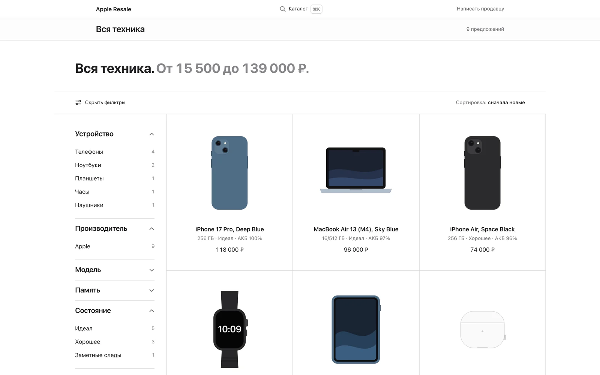
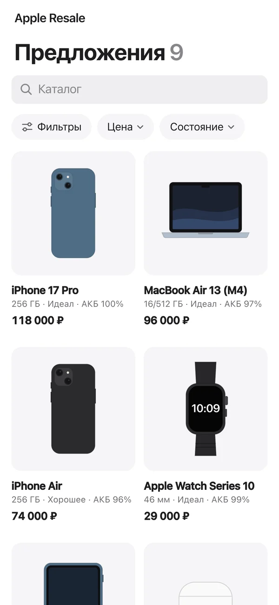
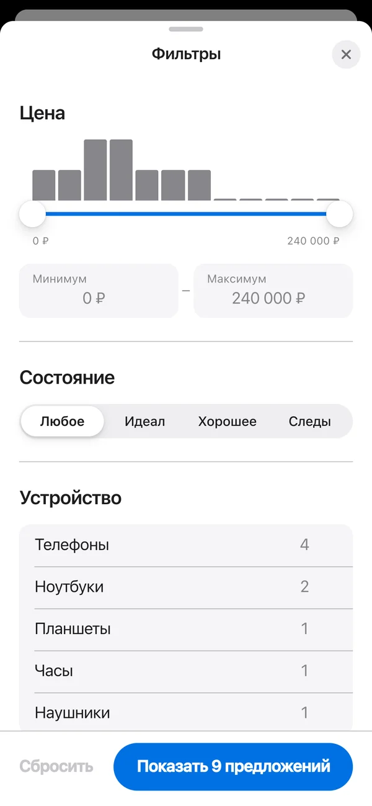
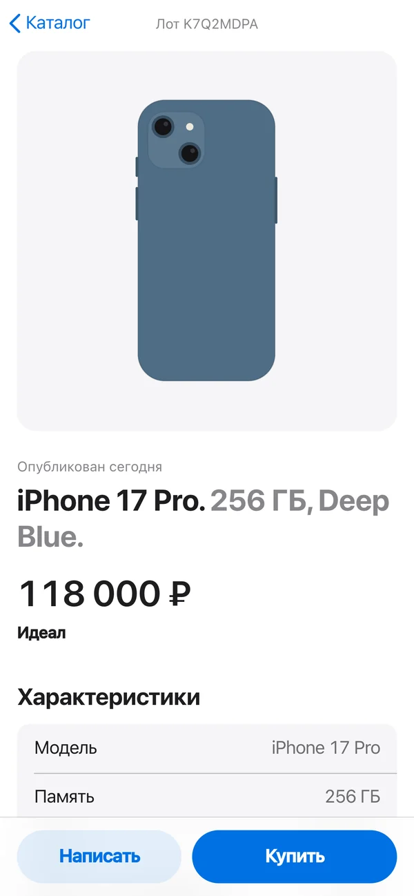
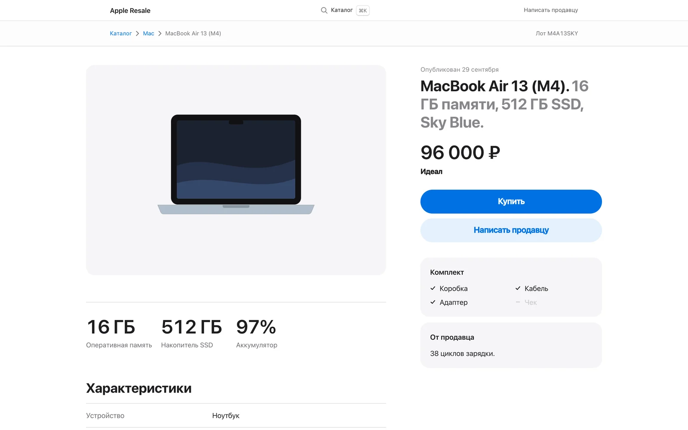

# Telegram Store

A Telegram bot, channel publisher, Mini App and website for one used-electronics reseller, built from one backend and one React app.

History: this is a public snapshot of a private repository (51 commits, 21 to 29 Sep 2026). Client details are replaced.

The seller adds a device through a step-by-step bot wizard, and the listing goes out to a Telegram channel, the Mini App and the website at once. Buyers filter listings and send a request, and the listing disappears everywhere once it is sold.



<p>
  
  
  
</p>



The UI is in Russian. The screenshots come from a local run with sample listings that have no photos, so the app draws device silhouettes.

## Key technical decisions

**One process, one frontend.** FastAPI runs the aiogram 3 bot as a webhook handler (`/tg/webhook`), the JSON API (14 routes plus health) and the built SPA. The same React build is the Mini App inside Telegram and the website in a browser: it checks `Telegram.WebApp.platform` to switch to Telegram mode (white header and bottom bar, the Telegram back button, t.me links opened inside the client) and checks `initData` to pick the buy path and open the admin page.

**Tags are derived, never typed.** `build_tags(item)` turns fields into slugs (`device:phone`, `model:iphone-15-pro`, `battery:90plus`, `price:30-60k`). Filters combine with AND across tag kinds and OR inside one kind. The catalog holds 109 Apple models in 5 categories. The wizard shows 10 brand buttons, any other brand is typed, and a table of 30 known brands, 47 synonyms and stripped corporate suffixes keeps "samsung" and "Samsung Electronics" as one tag.

**Data model.** SQLite in WAL mode, SQLAlchemy 2 async, 8 tables (items, photos, channel_messages, tags, item_tags, leads, events, subscribers), 3 Alembic migrations with tests that upgrade real data. Each wizard step writes to a draft row, so a restart does not lose input.

**The hard parts.**
- A Telegram album cannot carry inline buttons, so a channel post is one photo message with up to two buttons (the seller button needs `SELLER_USERNAME`). Its `message_id` is saved in the same transaction that makes the listing active, and a sale deletes it. Telegram refuses to delete posts older than 48 hours for bots in some cases; then the caption becomes "sold" and the buttons go away.
- A Mini App opened from a reply keyboard gets empty `initData`. The buy flow has three paths: API call with HMAC-checked `initData` (24 hour limit), `sendData` back to the bot, and a web form with a honeypot and 5 requests per IP per hour. A repeat request from the same contact for the same listing within 10 minutes is saved but does not notify the seller again.
- Media stays in Telegram: the app stores `file_id`, downloads on first request, makes 400 px and 1280 px JPEGs and serves video with HTTP Range. The Bot API download limit of 20 MB is enforced in the wizard.
- Filter counts are facets: each value shows how many listings match the other selected kinds. The price slider sits on a 12-bucket histogram with round steps.
- New listings go out to bot subscribers at no more than 20 messages per second, with `RetryAfter` handling and blocked users marked and skipped.

**Tests.** 340 pytest tests in 21 files, about 6,000 lines, run offline in under 20 seconds. A fake Bot API records every call and validates HTML the way Telegram does; that check found a `/start` crash that had been live since stage 5.

**Agent loop.** The project was built by Claude Code sessions working through [`LOOP.md`](LOOP.md) against the spec in [`CLAUDE.md`](CLAUDE.md) (both in Russian). The main session writes a contract per stage, hands pieces to Sonnet and Opus subagents, accepts work only after reading the diff and running the tests itself, and deploys to staging. A human checks the Telegram side by exact checklists. The loop stops on a missing secret or decision, three failures in a row, a conflict with the spec, or a failed health check after deploy.

## Stack

- Backend: Python 3.12, FastAPI, aiogram 3, SQLAlchemy 2 (async) with aiosqlite, Alembic, Pillow, pydantic-settings, uv.
- Frontend: React 18, TypeScript, Vite, Tailwind, React Router.
- Deploy: Docker Compose with Caddy for production ([`deploy/PROD.md`](deploy/PROD.md), in Russian); systemd and nginx for staging.
- Size: about 6,300 lines of Python in the app, 6,000 lines of tests, 5,600 lines of TypeScript and CSS.

## Run locally

Requires Python 3.12 with [uv](https://docs.astral.sh/uv/) and Node 20.19 or later.

```bash
# frontend build, served by the backend
cd web
npm ci
npm run build
cd ..

# backend
cd backend
uv sync
uv run pytest -q
export BOT_TOKEN=123456:local-dummy-token SET_WEBHOOK_ON_START=0 DB_PATH=./app.db MEDIA_DIR=./media
uv run alembic upgrade head
uv run uvicorn app.main:app --port 8000
```

Open http://127.0.0.1:8000/ for the website and http://127.0.0.1:8000/api/health for the health check. The catalog is empty until listings are published through the bot. For frontend work, `npm run dev` in `web/` proxies `/api` to `http://127.0.0.1:8000`.

With `SET_WEBHOOK_ON_START=0` and a dummy token the app makes no calls to Telegram. A working bot needs a real token, a channel, a public HTTPS URL and the variables in [`.env.example`](.env.example). The shop name is `SHOP_NAME` for the bot and `VITE_SHOP_NAME` for the web build (default "Apple Resale").

## Status

Client project, in progress. Stages 1 to 9 and 11 are built and run on staging: wizard, channel publishing, sales, public API, media, buyer requests, storefront, admin page in the Mini App, bot keyboards and subscriber broadcasts. Production (stage 10) is prepared and tested locally in Docker: Dockerfile, Compose, Caddy, daily database backup to a Telegram chat. Not done: the production launch, which waits for the client's domain and server, and the client's acceptance of the Telegram side.

## History

This snapshot is published without its commit history, because the history holds client correspondence. The private repository has 51 commits made between 2026-09-21 and 2026-09-29.

## License

MIT, see [LICENSE](LICENSE). Copyright (c) 2026 Lev Skorokhodov.
